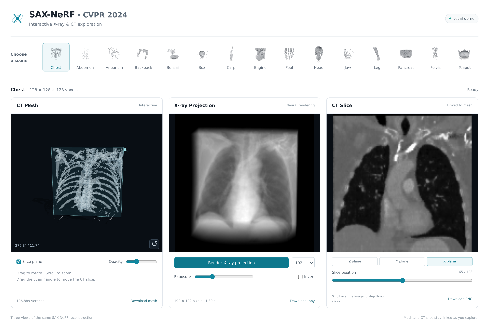

# SAX-NeRF interactive demo

[Open the online demo](https://huggingface.co/spaces/CaiYuanhao/SAX-NeRF), or run the same interface locally.

A local viewer with three linked panels in one row: **CT mesh with a movable
slice plane**, **SAX-NeRF X-ray projection**, and **CT slice**. All 15 pretrained
scenes are available. The viewer uses the reconstructed radiodensity field;
dataset reference CT values are not displayed.

[](https://huggingface.co/spaces/CaiYuanhao/SAX-NeRF)

## Start

First install the SAX-NeRF environment described in the repository README,
including its CUDA hash encoder. From the repository root:

```sh
conda activate sax_nerf
pip install -r demo/requirements.txt
python demo/run.py
```

Open **http://127.0.0.1:7864** in a browser with WebGL enabled. A CUDA GPU is
required for reconstruction and neural X-ray rendering. TIGRE is not required
by this demo.

The first visit to a scene reconstructs its native CT from the pretrained
checkpoint and caches its mesh. Existing `data/<scene>_50.pickle` and
`pretrained/<scene>.tar` files are used when present; missing files are downloaded
from the SAX-NeRF Hugging Face dataset and model repositories. Subsequent visits
reuse the local cache. Choose a cache directory on a disk with sufficient space:

```sh
python demo/run.py --gpu-id 0 --cache-dir /path/with/space/sax-demo-cache
```

To prepare all 15 scenes for offline use:

```sh
python demo/run.py --prepare-all --cache-dir /path/with/space/sax-demo-cache
python demo/run.py --offline --cache-dir /path/with/space/sax-demo-cache
```

For a remote GPU machine, forward the local port with
`ssh -L 7864:127.0.0.1:7864 user@gpu-host`, then open the same localhost URL on
your own computer. The server binds to `127.0.0.1` by default.

## Controls

- Select a scene by clicking its thumbnail; all three panels update.
- Drag the mesh to rotate, scroll to zoom, and use the reset button to return
  to the initial view. Mesh opacity and slice-plane visibility are adjustable.
- Move the CT slider, scroll over the CT image, or drag the cyan handle in the
  mesh to change the slice. All three native X, Y, and Z planes are supported.
  A transparent plane marks the selected position without covering the mesh;
  the corresponding native CT slice is displayed in the right-hand panel.
- Click **Render X-ray projection** after rotating the mesh to render the
  corresponding viewing direction through SAX-NeRF. Resolution, exposure,
  and grayscale inversion can be changed. Previously rendered directions are
  cached; exposure and inversion reuse the raw projection.
- Download the full native-grid mesh as GLB, the CT slice as PNG, or the raw
  floating-point X-ray projection as NumPy `.npy`.

## Environments and options

The browser UI and model worker may use separate Python environments. This is
useful when keeping the original PyTorch 1.11 / Python 3.9 environment:

```sh
# Run with a Python environment containing demo/requirements.txt.
python demo/app.py --model-python /path/to/sax_nerf/bin/python --gpu-id 0
```

Other options include `--port`, `--scene`, `--data-dir`, `--weights-dir`,
`--cuda-home`, and `--cxx`. Run `python demo/run.py --help` for the full list.
The ignored `demo/local_config.json` can store machine-specific defaults:

```json
{
  "ui_python": "/path/to/ui-env/bin/python",
  "model_python": "/path/to/sax_nerf/bin/python",
  "cache_dir": "/path/to/cache",
  "gpu_id": "0"
}
```

`run.py` uses `ui_python` when provided. The worker inherits the selected model
environment's build tools. A matching CUDA toolkit and compiler can be selected
with `--cuda-home` and `--cxx`; worker errors are recorded in
`<cache-dir>/worker.log`.

The interactive mesh is extracted from a subsampled CT grid to keep browser
interaction responsive. CT slices use the full native reconstruction, and
**Download mesh** extracts the full native-grid surface. X-rays use the original
SAX-NeRF neural ray renderer with deterministic sampling through the CT bounds.
The demo renders arbitrary viewing angles for exploration; it does not run the
held-out-view benchmark or report benchmark metrics.

All JavaScript dependencies are vendored locally. No CDN connection is needed
after the models and data have been cached. The Three.js MIT license is included
in `static/vendor/three/LICENSE`.

## Hugging Face Space

The Space uses `space_app.py` with Gradio and ZeroGPU. It serves the same three-view frontend as the local demo. Native float32 predicted CT arrays are stored losslessly for CPU slice browsing and mesh extraction; default X-rays are cached outputs of the neural renderer. New camera views call the original Lineformer network and CUDA hash encoder inside a short GPU allocation.

The top-right counters show successful manual X-ray renders and native mesh exports today and in the last 30 days, using America/Los_Angeles dates. Automatic previews, page refreshes and slice browsing do not count. Statistics persist in the private `CaiYuanhao/space-success-stats` dataset; configure its dedicated read/write Secret using `SPACE_STATS_TOKEN` or select an existing Secret name with `SPACE_STATS_TOKEN_NAME`. No usage token is included in source code or browser responses.

`requirements-space.txt` pins the hosted environment. `build_encoder.py` builds the original CUDA kernels into a wheel for that PyTorch/Python version. The local demo keeps its original CUDA extension build fallback.
